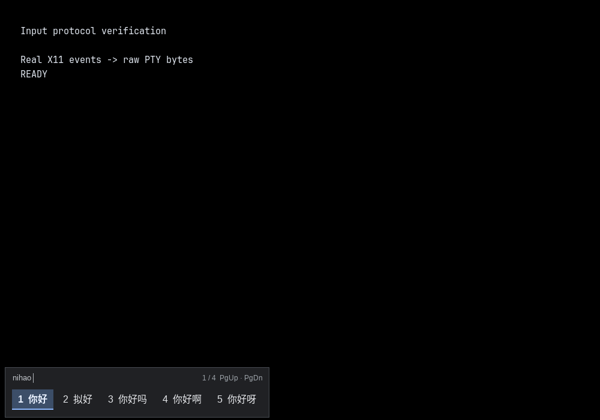

# Ztty 原生输入验收与 Project Z 来源核对

日期：2026-11-20。范围：zinput XIM 适配器、ztype 0.4.0 的真实 Ztty 消费路径，以及 Project Z 聚合仓库的依赖来源。

本记录已按用户最新的“ztty输入测试”要求，对 SHA-256 为 066902ba 开头的最终构建重新验收两个真实 Ztty 映像。该构建包含 63ad9f12a7995aff9fb4b0267a845977bea24b55 的 Wayland grab 退休竞态修复，其 13 项定向测试和 Clippy 已通过。[定向门禁](wayland-grab-tests.txt)

## 提纲

- 用真实安装的 Ztty 验证晚启动、重连、原生文字提交与候选绘制。
- 固定二进制与词库指纹，保存可复查的 PTY 记录和截图。
- 核对聚合仓库中的直接、传递消费者及版本约束。
- 区分本轮已验证的行为、应用通知边界与尚未合流的依赖版本。

## 结果与适用范围

本轮 ztype release 在两个真实安装的 Ztty 映像中均通过 12 项检查。一个是 PATH 中的 Ztty 0.5.2，另一个是宿主现有终端使用的 oh-my-ztty 0.2.3 包内 Ztty 0.5.0。两种映像均在独立 Xvfb 中启动；每次先打开终端，再启动名为 fcitx 的 XIM 服务。测试随后在同一终端中停止、重启服务，确认它能自动重新连接。这个结果证明这些二进制的晚连接与恢复路径可用；本轮没有切换用户正在使用的桌面输入法。[PATH 记录](ztty-path-0.5.2.json)、[旧映像记录](ztty-active-0.5.0.json)

原生提交确实进入了终端子进程的 PTY。测试通过 XTEST 产生拼音按键，接收进程直接读取原始 PTY 字节，分别得到“你好”“世界”和“输入法”。其中“输入法”通过外部完整词库验证。测试未使用剪贴板或粘贴替代输入法提交；两个窗口共用 Ztty broker，并分别验证了焦点切换后的文字归属。[测试夹具](../../../native/x11/tests/check_ztty.py)

候选框已在实际屏幕像素中确认绘制。仅检查 X11 窗口已映射会早于异步字形绘制，曾产生空白的早期截图；夹具现等待候选区域出现亮文字像素和多个字形颜色再保存截图。最终两个映像的截图一致，区域包含 996 个亮像素、550 种颜色，显示 nihao、1/4 页以及五个可读候选。自动像素门禁只判断绘制已发生；文字内容另经人工视觉复核。

候选框在这个 Ztty 客户端中位于窗口左下方。该客户端使用 XIM PreeditNothing/StatusNothing，未提供 XIC 光标位置，所以适配器采用窗口内的备用位置。本轮没有把这个结果表述为光标旁定位已完成。

## 固定实验输入

| 项目 | 值 |
| --- | --- |
| ztype 版本 | 0.4.0 release |
| ztype SHA-256 | 066902ba0497f53c5ec963bb94e5deb00ade361a14d232501ab01c7d7604d5fe |
| 外部 TSV SHA-256 | 504e9f69e794584375bbfedef937230e5dc76faff9c7696cc9285aff64cc18d9 |
| 候选截图 SHA-256 | 7f22bdce71fdbafc6256fa535d57d4bd3737ba0067265f2a60f0e69f478baeec |
| 私有屏幕 | 1000 × 700 |
| 候选区域 | x=8，y=612，width=441，height=84 |
| 每次测试残留自有进程 | 0 |

12 项检查覆盖服务启动前的普通文字、晚启动连接、多字符原生提交、外部词库提交、同 broker 第二窗口、第二窗口输入、焦点返回、候选映射位置、实际候选绘制、取消后隐藏、服务停机期间普通按键，以及服务重启后连接。两个映像均使用本提交中的正式 --expect-commit 参数，最终固定构建各通过 12/12。

在具备 Xvfb、python-xlib、Pillow、xdotool 及 Ztty 源码测试辅助模块的开发环境中，可运行：

~~~sh
python3 native/x11/tests/check_ztty.py \
  --ztty /home/lightjunction/.cargo/bin/ztty \
  --ztty-source /home/lightjunction/Documents/GITHUB/project_z/ztty \
  --server /home/lightjunction/Documents/GITHUB/project_z/dist/ztype-daily-20261120/target/release/ztype \
  --server-mode ztype \
  --name fcitx \
  --dictionary /home/lightjunction/Documents/GITHUB/project_z/dist/ztype-engine-20261120/target/test-vocabulary/rime-ice.tsv \
  --expect-commit 'shurufa ' 输入法 \
  --output target/ztty-acceptance.json \
  --screenshot target/ztty-candidate.png
~~~

夹具会自行创建并验证私有显示、配置目录和终端 broker。fcitx 在这里是兼容已有 XMODIFIERS 配置的服务名称，未改为框架代码中的固定默认值。

## Project Z 来源核对

来源快照采集时 origin/main 为 0d638519117e375410743e61013114a6187b7f96。它相对独立工作树基线 76dd114c11685d430dd55bb0d78b064a7349af73 只增加了管理脚本、测试及文档，以下输入和 UI gitlink 未改变。执行 impact --repositories zinput 得到 zinput、ztype、zterm、ztty、oh-my-ztty；仅修改 ztype 的影响集合为 ztype。[来源快照](source-graph.json)

| 位置 | 固定来源或约束 |
| --- | --- |
| 聚合 zinput | 37617313dd7aaabcca9dd567344a76c4cbe03907，0.1.3 |
| 聚合 ztype | 9dd67a54ac536b22ab0fe4bd008d6b5cdd95c369，0.1.0 |
| 聚合 zgpui | 5b268da910639abd2fb8e581acb4f6eed50b7516，0.1.2 |
| 聚合 ztty | 6e2ce246b0b50e6b82da99756832feae6e966f21，0.5.2 |
| 聚合 zterm | b5adc3dbc5ca5f28a3ea7e45650a45245be9dc2d，0.5.2 |
| oh-my-ztty | 1e3ce8d3e5a141d09e450fd3f635f987a5732be4 |
| ztty/crates/zinput | 37617313dd7aaabcca9dd567344a76c4cbe03907 |
| ztty 的 zgpui 依赖 | 精确 0.1.2；嵌套来源 5b268da910639abd2fb8e581acb4f6eed50b7516 |
| 最终 XIM 实验构建的 ztype/vendor/zinput | 63ad9f12a7995aff9fb4b0267a845977bea24b55，含本轮运行时修复 |
| 新 ztype/vendor/zgpui | b09f3ded0928df5a35bad32dcd5539560b8617e6，精确 0.1.5，含 raster |
| oh-my-ztty/components/ztty | 6e2ce246b0b50e6b82da99756832feae6e966f21 |

聚合仓库的来源规则阻止只替换 zinput、ztype 两个 gitlink 后直接宣称传播完成。equivalent_source 要求嵌套源码和 canonical checkout 的 HEAD 相同且工作树干净；validate 同时检查精确版本约束和非 canonical 路径。因此，更新 canonical zinput 后，ztty 的嵌套 zinput 与套件中的 ztty 来源需要按顺序跟进。zterm 的现有 0.1.3 版本约束兼容本轮 API，没有据此修改其业务代码。[协调器规则](https://github.com/LIghtJUNction/project-z/blob/0d638519117e375410743e61013114a6187b7f96/scripts/project_z.py)

zgpui 的差异需要单独的 UI 版本协调。新 ztype 使用精确 0.1.5 及其 raster 子包，而已验收的聚合图仍包含精确 0.1.2 的客户端。仅更新输入仓库不会消除这项冲突。本记录没有强升其他 UI 消费者、放宽来源检查，或改写套件的已发布二进制哈希。独立 input-cohort 工作树停留在 76dd114，未修改任何来源 pin；没有声称该候选组合已通过 sync、check 或 resolve --all。

## Wayland 应用通知边界

私有 GTK 对照实验还确认了一项应用侧通知边界。测试直接调用 gtk_entry_set_text 和 gtk_editable_set_position，未调用输入上下文 reset；GTK 内部文字变为 application-edit，但 Wayland trace 没有发送这段 surrounding_text，也没有对应的外部修改状态提交。最后一次 preedit 回调之后约六秒，下一次状态更新来自测试退出时的 disable。此时输入法无法从协议得知应用内部文字已替换；本轮没有为不可见的变化添加推测性框架补丁。[双侧协议摘录](gtk-external-edit-notification.txt)

zinput 已有明确的外部修改通路：ChangeCause(OTHER) 在 done 时递增 generation、清空已发布的 preedit 并隐藏候选；host 随新 generation 清空合成状态。单元测试 external_edit_invalidates_once_without_a_focus_transition、initial_other_and_normal_echo_do_not_reset_twice 和 popup_waits_for_partial_context_batches_to_complete 覆盖该状态逻辑。它们是状态单元证据，不等于未通知应用的端到端保证。[状态实现与单元测试](../../../native/wayland/src/lib.rs)

## 结论与证据对应

| 结论 | 证据 | 状态 |
| --- | --- | --- |
| 两个真实 Ztty 映像支持晚启动与重启后 XIM 连接 | 两份 12/12 PTY 记录 | 已支持 |
| 完整词库文字通过原生提交到达 PTY | 输入法的逐字节断言 | 已支持 |
| 候选框实际绘制且可读 | 像素门禁、保存截图、视觉复核 | 已支持 |
| 所有宿主应用都已可用 | 本轮未覆盖所有应用，且未切换宿主会话 | 不作此结论 |
| 两个顶层 gitlink 足以完成整个 Project Z 传播 | 来源与精确版本约束显示还需后续协调 | 不成立 |
| 无协议通知的应用内部修改可由 IM 自动获知 | 私有 GTK 双侧 trace 没有通知 | 不作此保证 |

## 自审

- 贡献：记录的是可复现的框架与消费者行为，没有将修复称为新输入法算法。
- 清晰度：版本、指纹、命令、断言、来源约束均已列出，候选位置的限制明确。
- 实验强度：验证真实安装二进制、真实 XIM 通信及原始 PTY，采用私有环境避免干扰现有输入。
- 覆盖范围：区分状态单元测试、私有 GUI 验收、宿主切换和聚合传播，没有以其中一种代替其他门禁。
- 设计合理性：测试等待真实绘制；对应用不发通知的情形不引入无法由证据支持的推测性处理。
